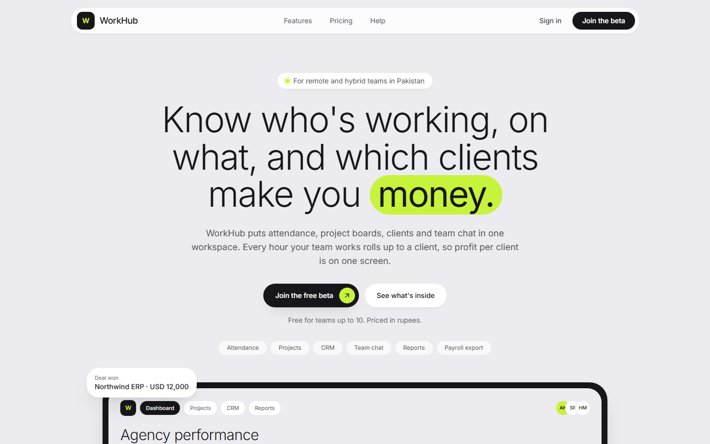

# WorkHub

**An all in one workspace for remote and hybrid teams: attendance, project boards, CRM and team chat in one place.**

Every hour a team works rolls up to a client, so profit per client is on one screen.

🔗 **Live preview:** [workhub-staging.onrender.com](https://workhub-staging.onrender.com)

> WorkHub is my personal SaaS product and is in active development. The source code is private. This repository is a public overview of the project.

  

## What it does

**Attendance**
- One tap check in and out on phone or web, with selfie, time, IP and device
- Shifts, including night shifts across midnight, breaks and grace periods
- Office sites by GPS radius or office IP, with flagged (not blocked) check ins
- Offline check in that syncs automatically when the connection comes back
- Leave types, balances and approvals, public holidays, corrections and payroll export

**Projects**
- Kanban boards with drag and drop on mouse, touch and keyboard
- Tasks with assignees, priorities, due dates, checklists, subtasks and file attachments
- Live board updates, comments with @mentions, time logging and budget alerts
- List view, bulk edit, My Work view and project templates

**CRM**
- Companies, contacts and deals linked to projects
- Activities and reports, including client profitability

**Team chat**
- Public and private channels, direct and group messages, threads and @mentions
- Live delivery, presence from attendance and task cards inside messages
- Announcements with read receipts

**Workspace and security**
- Invites by email, CSV or join link, roles and an audit log
- Email verification, Google sign in and two factor authentication
- Every company's data isolated at the database level

## Tech stack

| Area | Tools |
| --- | --- |
| Frontend | Next.js 16, React, TypeScript |
| Backend | NestJS 11 (modular monolith), REST, Server-Sent Events |
| Database | PostgreSQL with Row-Level Security, Drizzle ORM |
| Monorepo | npm workspaces, Turborepo, shared zod schemas |
| Infrastructure | Render, Cloudflare R2 file storage, Resend email |
| Quality | GitHub Actions CI, 200+ integration and unit tests, tenant isolation tests |

## How it is built

- **Multi tenant by design.** Each company is a workspace. Every workspace table has PostgreSQL Row-Level Security forced on, and the API runs as a database role that cannot bypass it, so a missed filter still cannot leak another company's data.
- **Secure auth.** Argon2id password hashes, hashed session tokens in HttpOnly cookies, rate limited sign in and single use, expiring email links.
- **Real time without the complexity.** Boards and chat update live over Server-Sent Events, which work through ordinary proxies and reconnect on their own.
- **Built for Pakistan first.** Night shifts, prayer breaks, Pakistani public holidays, Urdu file names and pricing in rupees, with international expansion planned.

## Status

- Core modules (attendance, projects, CRM, team chat) are built and running on staging
- Public beta planned for February 2027
- Paid launch in Pakistan planned for May 2027

## About me

Built by **Arbaz Khan**, Full Stack Developer (WordPress, Shopify, SaaS and AI automation).

- Portfolio: [arbazkhan.space](https://arbazkhan.space)
- LinkedIn: [linkedin.com/in/arbazkhan-webdev](https://www.linkedin.com/in/arbazkhan-webdev/)
- GitHub: [github.com/arbaz-webdev](https://github.com/arbaz-webdev)

Interested in WorkHub or want a demo? Reach out on LinkedIn.
